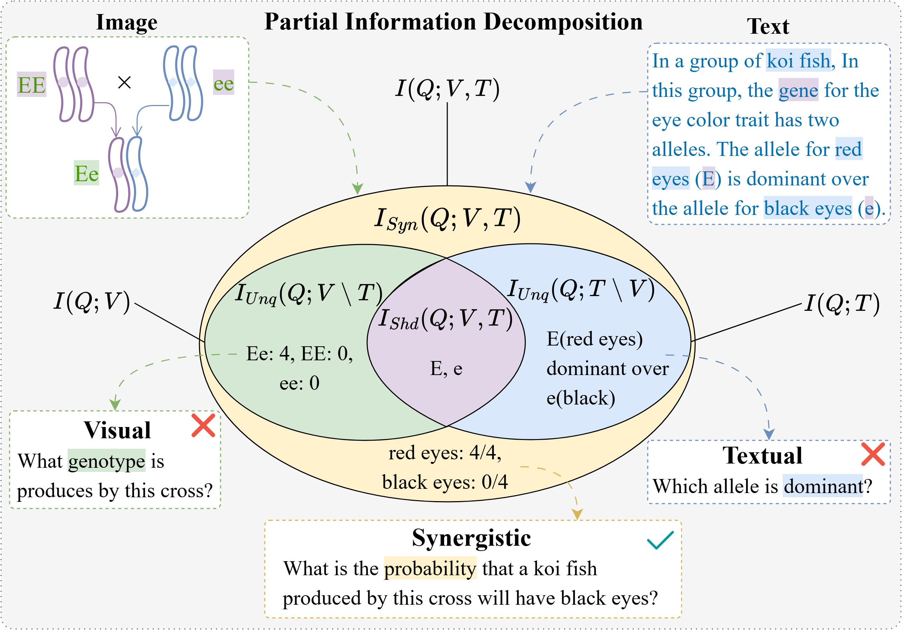

# SynMQG: From Disentanglement to Synergy

Multi-modal question generation with multimodal disentanglement, von Mises-Fisher modeling, partial information decomposition, and GRPO.

## Overview

SynMQG is a multimodal question-generation framework for tasks where a high-quality question requires jointly using visual and textual information. The framework separates modality-specific information from cross-modal shared information, then encourages generated questions to depend on useful interactions between both sources.

The example below illustrates the target behavior. Visual and textual information provide complementary evidence: neither source alone is sufficient for the final question, while their joint information supports a synergistic question.

<p align="center">
  
</p>

<p align="center"><em>Illustration of visual-textual synergy measured through partial information decomposition.</em></p>

The implementation contains:

- An MLLM backbone interface for Qwen-VL and other supported multimodal backbones.
- Disentanglement with shared cross-attention resampling and private gated branches.
- Mutual-information objectives based on Gaussian and von Mises-Fisher formulations.
- PID-based teacher scoring and reward modeling.
- Supervised training, GRPO training, inference, and pairwise synergy evaluation scripts.

This is research software. Paths, model names, and data locations in the YAML files are examples and should be adapted to the local environment.

## Repository structure

```text
Syn_MQG/
|-- config/
|   |-- mllm_early_disentangle_gauss_mi.yaml
|   |-- mllm_grpo_gauss_mi.yaml
|   `-- pid_reward_model.yaml
|-- data/
|   |-- hybridqa/
|   |-- multimodalqa/
|   `-- scienceqa/
|-- scripts/
|   |-- train_mllm_early_disentangle_gauss_mi.py
|   |-- train_mllm_grpo_gauss_mi.py
|   |-- inference_mllm_early_disentangle_gauss_mi.py
|   |-- compute_pid_teacher_scores.py
|   |-- evaluate_llama_factory_predictions.py
|   `-- evaluate_synergy_pairwise_gpt.py
`-- src/
    |-- data/
    |-- evaluation/
    |-- models/
    `-- reward/
```

## Installation

Create an environment with Python and install the dependencies required by the selected backbone, training scripts, and evaluation scripts.

The project uses packages from these groups:

- PyTorch and compatible image tooling.
- Transformers, PEFT, Accelerate, and DeepSpeed.
- NumPy, PyYAML, Pillow, and tqdm.
- NLTK, ROUGE, Sentence Transformers, spaCy, and Hugging Face Evaluate.
- An OpenAI-compatible client for pairwise GPT-based evaluation.

Run commands from the `Syn_MQG` directory so imports such as `src.models` resolve correctly.

## Data

The repository includes JSON splits for HybridQA, MultimodalQA, and ScienceQA. Training configurations may refer to additional preprocessed files, image roots, or external dataset directories.

Before training, verify that:

- `train_file` and `val_file` exist.
- `image_root` points to the corresponding image directory.
- The model checkpoint path is accessible.
- The JSON schema matches the fields expected by `MLLMDataset`.

## Configuration

- `config/mllm_early_disentangle_gauss_mi.yaml`: supervised early-disentanglement training.
- `config/mllm_grpo_gauss_mi.yaml`: GRPO training with LoRA and PID-related rewards.
- `config/pid_reward_model.yaml`: PID projection, scoring, and reward-model settings.

Important settings include the backbone path, backbone type, LoRA options, shared/private disentanglement dimensions, training schedule, dataset paths, output directories, and inference limits.

## Training

### Supervised disentanglement training

```bash
deepspeed --num_gpus=<NUM_GPUS> \
  scripts/train_mllm_early_disentangle_gauss_mi.py \
  --config config/mllm_early_disentangle_gauss_mi.yaml \
  --deepspeed <DEEPSPEED_CONFIG>
```

The training script supports staged optimization. When `training.stage2` is enabled, set `training.load_pretrained` to the stage-one checkpoint and configure LoRA training as required.

### GRPO training

```bash
deepspeed --num_gpus=<NUM_GPUS> \
  scripts/train_mllm_grpo_gauss_mi.py \
  --config config/mllm_grpo_gauss_mi.yaml \
  --deepspeed <DEEPSPEED_CONFIG>
```

The GRPO configuration controls sampled responses, temperature, PPO/KL weights, PID scorer mode, reranker path, and reward weights.

## PID teacher scores and reward modeling

Compute PID teacher scores with either the Gaussian or von Mises-Fisher scorer:

```bash
python scripts/compute_pid_teacher_scores.py \
  --config <PID_CONFIG> \
  --mode vmf
```

Use `--mode gaussian` for the Gaussian scorer. Generated score files and projector/scorer checkpoints must match the paths configured for later reward-model or GRPO training.

## Inference

```bash
python scripts/inference_mllm_early_disentangle_gauss_mi.py \
  --config config/mllm_early_disentangle_gauss_mi.yaml \
  --checkpoint <CHECKPOINT> \
  --test_file <TEST_JSON> \
  --output_file <OUTPUT_JSONL>
```

Use `--load_lora` when the checkpoint contains LoRA weights. A separate GRPO checkpoint can be supplied with `--grpo_checkpoint`.

## Evaluation

### Standard generation metrics

`evaluate_llama_factory_predictions.py` evaluates JSONL predictions with the metrics implemented in `src/evaluation/metrics.py`, including BLEU, ROUGE, METEOR, BERTScore, BLEURT, and Distinct-n.

### Pairwise synergy evaluation

`evaluate_synergy_pairwise_gpt.py` compares two prediction files with an OpenAI-compatible API. Configure the API endpoint and key securely, then run:

```bash
python scripts/evaluate_synergy_pairwise_gpt.py \
  --predictions_a <PREDICTIONS_A> \
  --predictions_b <PREDICTIONS_B> \
  --data_file <DATA_FILE> \
  --output <RESULTS_JSONL> \
  --summary <SUMMARY_JSON> \
  --api_key <API_KEY> \
  --api_url <API_URL>
```

Use `--resume` to continue an interrupted run and `--num_workers` to control concurrency.

## Outputs

Depending on the configuration, outputs include:

- Model and LoRA checkpoints.
- PID projectors, teacher scores, and scorer checkpoints.
- Generated prediction JSONL files.
- Standard metric summaries.
- Pairwise evaluation results and aggregate summaries.

Output directories are controlled by the YAML `output` sections and by the command-line arguments of each evaluation script.
